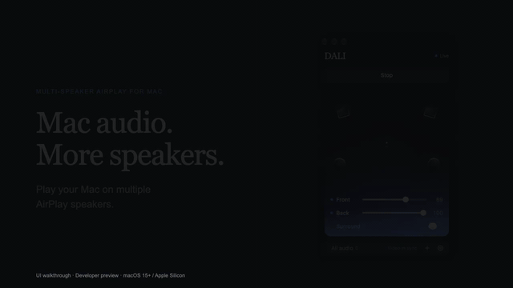

# DALI — Multi-speaker AirPlay for Mac

DALI sends Mac audio to several AirPlay speakers, with a separate volume for each. An optional Chrome extension delays supported video to match the audio.

> **Developer preview.** Source and extension packages are available. A signed, notarized Mac download and Chrome Web Store listing are not available yet.

## See the app

[Watch or download the 20-second video](https://github.com/fortun8te/dali/releases/download/v1.2.0-preview.1/DALI-AirPlay-demo.mp4). It shows the real UI, not a physical speaker-sync test.

## Install

Requirements: macOS 15 or later, Apple Silicon, Chrome (for video sync only), and AirPlay speakers on the same local network.

Get the [developer preview release](https://github.com/fortun8te/dali/releases/tag/v1.2.0-preview.1) or [build from source](docs/building.md). The [setup guide](docs/getting-started.md) covers permissions and first run.

## Chrome video sync

The optional Chrome extension delays HTML video (YouTube, TikTok, Instagram Reels and other players) so the picture matches the audio DALI sends to your speakers. It follows the delay DALI reports and cannot measure what reaches your seat. DRM, picture-in-picture, fullscreen and live streams may not sync.

## Links

- [Setup guide](docs/getting-started.md) · [Build from source](docs/building.md) · [Compatibility tests](docs/compatibility.md)
- [Privacy](PRIVACY.md) · [Report an issue](https://github.com/fortun8te/dali/issues) · [Speaker compatibility report](https://github.com/fortun8te/dali/issues/new?template=speaker-compatibility.md)

## License

The DALI app and extension are MIT licensed. The bundled [OwnTone](https://github.com/owntone/owntone-server) engine (`third_party/owntone`) and other dependencies keep their own licenses.

DALI is an independent project and is not affiliated with DALI Speakers, Apple, Google, YouTube, TikTok or Instagram.
